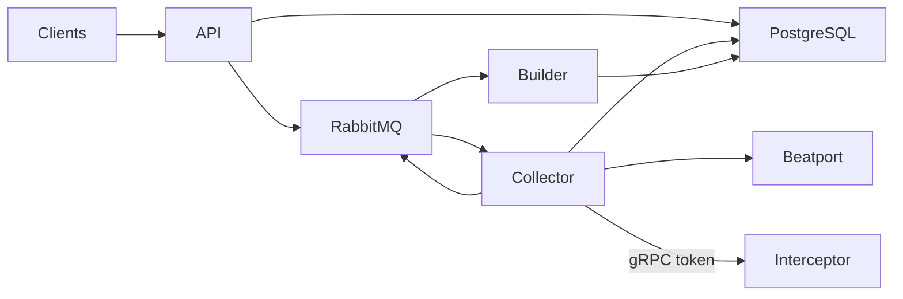

# Beatport2Rss

Beatport2Rss is a .NET project for collecting Beatport releases for followed artists and labels. Its goal is to make these releases available as RSS feeds. The project is under active development: account, feed, and subscription management, scheduled collection, and release processing are implemented, while RSS generation and public delivery are not yet available.

## Current status

- **API:** versioned REST API for users and sessions, feeds, subscriptions, and tags.
- **Collector:** scheduled worker that retrieves releases from Beatport and publishes collected release events.
- **Builder:** processes release and management events and stores the corresponding data; it also removes stale releases.
- **Token interceptor:** gRPC service used by workers to obtain Beatport access tokens.
- **RSS output:** not implemented yet. Feed management exists in the API, but the project does not currently generate or expose RSS documents.

## Architecture



The API and workers use PostgreSQL for persistence and RabbitMQ for asynchronous integration events. The collector calls Beatport and obtains access tokens through the interceptor service. The builder processes collected releases and API events.

## Technology

- .NET 10 / C# 14
- ASP.NET Core minimal APIs
- PostgreSQL and Entity Framework Core
- RabbitMQ and Wolverine
- Quartz scheduled jobs
- Docker Compose

## Run with Docker Compose

Prerequisites: Docker with the Compose plugin and valid Beatport credentials.

From the repository root, create and edit the local environment file:

```powershell
Set-Location docker
Copy-Item .env.example .env
```

Update `docker/.env` with your Beatport credentials and secure values for the database, RabbitMQ, and JWT settings. Do not commit this file; local `.env` files are ignored by Git.

Start the services in the same terminal:

```powershell
docker compose up --build
```

Compose starts PostgreSQL, RabbitMQ, the token interceptor, database migrator, collector, builder, and API. The migrator runs after PostgreSQL is healthy; the workers and API wait for their required dependencies.

By default, the API is available at `http://localhost:8080` and its development API reference at `http://localhost:8080/scalar`. RabbitMQ management is available at `http://localhost:15672`. Ports and service settings can be changed in `docker/.env`.

Stop the services with:

```powershell
docker compose down
```

## Build and tests

Install the .NET 10 SDK, then run these commands from the repository root:

```powershell
dotnet restore Beatport2Rss.slnx
dotnet test Beatport2Rss.slnx
```

## Repository layout

| Path | Contents |
| --- | --- |
| `api/` | REST API, application/domain logic, persistence, and tests |
| `services/collector/` | Beatport release collection worker |
| `services/builder/` | Release and feed-related event processing worker |
| `services/interceptor/` | Beatport token interception gRPC service |
| `common/` | Shared domain, Beatport client, persistence, and messaging components |
| `tools/` | Database migrator and source generator |
| `docker/` | Docker Compose configuration and environment template |
