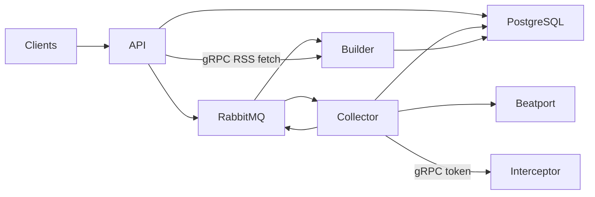

# Beatport2Rss

Beatport2Rss is a .NET project for collecting Beatport releases for followed artists and labels. Its goal is to make these releases available as RSS feeds. The project is under active development: account, feed, and subscription management, scheduled collection, and release processing are implemented, while RSS document generation is still in development.

## Current status

- **API:** versioned REST API for users and sessions, feeds, subscriptions, and tags.
- **Collector:** scheduled worker that retrieves releases from Beatport and publishes collected release events.
- **Builder:** processes release and management events and stores the corresponding data; it also removes stale releases.
- **Token interceptor:** gRPC service used by workers to obtain Beatport access tokens.
- **RSS output:** the API exposes stored RSS documents at `/feeds/{slug}/rss`; scheduled RSS document generation is still in development.

## Architecture



The API and workers use PostgreSQL for persistence and RabbitMQ for asynchronous integration events. The collector calls Beatport and obtains access tokens through the interceptor service. The builder processes collected releases and API events.

## Technology

- .NET 10 / C# 14
- ASP.NET Core minimal APIs
- PostgreSQL and Entity Framework Core
- RabbitMQ and Wolverine
- Quartz scheduled jobs
- Docker Compose

## Run with Docker Compose

Prerequisites: Docker with the Compose plugin and valid Beatport credentials.

From the repository root, create and edit the local environment file:

```powershell
Set-Location docker
Copy-Item .env.example .env
```

Update `docker/.env` with your Beatport credentials and secure values for the database, RabbitMQ, JWT, and Resend settings. Do not commit this file; local `.env` files are ignored by Git.

Start the services in the same terminal:

```powershell
docker compose up --build
```

Compose starts PostgreSQL, RabbitMQ, the token interceptor, separate API, Builder, and Collector migrators, the three backend application services, and the standalone web frontend. Each migrator runs after PostgreSQL is healthy and applies migrations only to its service's database. The API and workers wait for their own migrator to finish successfully, so a migration failure in one service does not block the others.

By default, the API is available at `http://localhost:8080` and its development API reference at `http://localhost:8080/scalar`. RabbitMQ management is available at `http://localhost:15672`. Ports and service settings can be changed in `docker/.env`.

Stop the services with:

```powershell
docker compose down
```

## Frontend

The Blazor frontend is located in `web/src/Beatport2Rss.Web` and is also included in the normal full-stack Compose startup. To run only the web service, use the commands below from the `docker` directory:

```powershell
docker compose up -d --build web
docker compose ps web
docker compose logs web
```

Browse to `http://localhost:8081` by default. Set `WEB_PORT` in `docker/.env` to use a different host port; the container continues to listen on port 8080. If you need a local Compose environment file, create one from the template with `Copy-Item .env.example .env`.

Starting only `web` does not start or require the API, database, messaging services, or valid Beatport credentials. Rebuild the frontend after making changes with:

```powershell
docker compose up -d --build web
```

Stop only the frontend with:

```powershell
docker compose stop web
```

For local development without Docker, run the web project from the repository root:

```powershell
dotnet run --project .\web\src\Beatport2Rss.Web\Beatport2Rss.Web.csproj
```

The initial frontend runs independently of the API and other backend services.
The `/register` and `/login` pages are informational placeholders. Use the shared language switch to choose English or Ukrainian; the choice is remembered in the browser.

## Build and tests

Install the .NET 10 SDK, then run these commands from the repository root:

```powershell
dotnet restore Beatport2Rss.slnx
dotnet test Beatport2Rss.slnx
```

## Repository layout

| Path | Contents |
| --- | --- |
| `api/` | REST API, application/domain logic, persistence, and tests |
| `web/` | Standalone Blazor frontend |
| `services/collector/` | Beatport release collection worker |
| `services/builder/` | Release and feed-related event processing worker |
| `services/interceptor/` | Beatport token interception gRPC service |
| `common/` | Shared domain, Beatport client, persistence, and messaging components |
| `tools/` | Database migrator and source generator |
| `docker/` | Docker Compose configuration and environment template |
