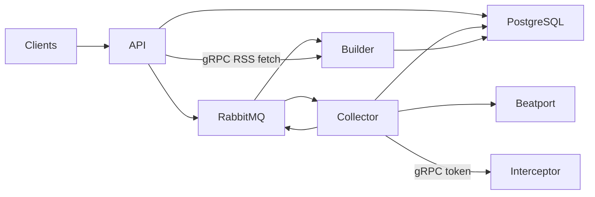

# Beatport2Rss

Beatport2Rss is a .NET project for collecting Beatport releases for followed artists and labels. Its goal is to make these releases available as RSS feeds. The project is under active development: account, feed, and subscription management, scheduled collection, and release processing are implemented, while RSS document generation is still in development.

## Current status

- **API:** versioned REST API for users and sessions, feeds, subscriptions, and tags.
- **Collector:** scheduled worker that retrieves releases from Beatport and publishes collected release events.
- **Builder:** processes release and management events and stores the corresponding data; it also removes stale releases.
- **Token interceptor:** gRPC service used by workers to obtain Beatport access tokens.
- **RSS output:** the API exposes stored RSS documents at `/feeds/{slug}/rss`; scheduled RSS document generation is still in development.

## Architecture



The API and workers use PostgreSQL for persistence and RabbitMQ for asynchronous integration events. The collector calls Beatport and obtains access tokens through the interceptor service. The builder processes collected releases and API events.

## Technology

- .NET 10 / C# 14
- ASP.NET Core minimal APIs
- PostgreSQL and Entity Framework Core
- RabbitMQ and Wolverine
- Quartz scheduled jobs
- Docker Compose

## Run with Docker Compose

Prerequisites: Docker with the Compose plugin and valid Beatport credentials.

From the repository root, create and edit the local environment file:

```powershell
Set-Location docker
Copy-Item .env.example .env
```

Update `docker/.env` with your Beatport credentials and secure values for the database, RabbitMQ, and JWT settings. Do not commit this file; local `.env` files are ignored by Git.

Start the services in the same terminal:

```powershell
docker compose up --build
```

Compose starts PostgreSQL, RabbitMQ, the token interceptor, separate API, Builder, and Collector migrators, the API and workers, and the standalone web service. Each migrator runs after PostgreSQL is healthy and applies migrations only to its service's database. The API and workers wait for their own migrator to finish successfully, so a migration failure in one service does not block the others.

By default, the API is available at `http://localhost:8080` and its development API reference at `http://localhost:8080/scalar`. RabbitMQ management is available at `http://localhost:15672`. Ports and service settings can be changed in `docker/.env`.

Stop the services with:

```powershell
docker compose down
```

## Frontend

The Blazor frontend is located in `web/src/Beatport2Rss.Web`. Run it from the repository root:

```powershell
dotnet run --project .\web\src\Beatport2Rss.Web\Beatport2Rss.Web.csproj
```

The frontend starts independently of the API and other backend services. The confirmation page uses the server-side `ApiBaseUrl` (default `http://localhost:5162`); with Compose the web service listens on `http://localhost:8081` and calls the API at `http://api:8080`. It shows a retryable error if the API is unavailable.

## Email confirmation

Registration always creates a Pending account. To enable automatic delivery, set `EmailConfirmation__Enabled=true` on the API (or `EMAIL_CONFIRMATION_ENABLED=true` in Compose) and configure:

| API setting | Compose variable | Purpose |
| --- | --- | --- |
| `EmailConfirmation__ApiKey` | `RESEND_API_KEY` | Valid Resend API key. Keep it in API user secrets, environment or a secret manager, never in the web container. |
| `EmailConfirmation__SenderAddress` | `EMAIL_CONFIRMATION_SENDER_ADDRESS` | Resend sender address on an appropriately verified sender/domain. |
| `EmailConfirmation__SenderName` | `EMAIL_CONFIRMATION_SENDER_NAME` | Email display name, such as `Beatport2Rss`. |
| `EmailConfirmation__PublicWebBaseUrl` | `EMAIL_CONFIRMATION_PUBLIC_WEB_BASE_URL` | Public, browser-reachable web URL used in links, not the API address. Use HTTPS in production. |
| `EmailConfirmation__Lifetime` | `EMAIL_CONFIRMATION_LIFETIME` | Positive duration, default `1.00:00:00` (24 hours), maximum 365 days. |

When delivery is disabled (the default), no new verification or delivery work is generated, and public confirmation links cannot be used. To allow manual activation in this mode, set `EmailConfirmation__AdministratorUserId` (Compose: `EMAIL_CONFIRMATION_ADMIN_USER_ID`) to the immutable database UUID of a trusted, operator-verified existing account. Obtain this ID through trusted database access, not an email address supplied by a registrant. That account can authenticate through the existing session API and use `PUT /users/{id}/activation` with its bearer token to activate **another** user without confirming email ownership. Without a configured administrator, nobody can use this operation. Manual activation is unavailable when delivery is enabled.

Opening a confirmation email link only reads state; the recipient must press **Confirm email**. The API does not sign the recipient in. Expiry does not change account status; a completed confirmation can still be acknowledged, but cannot reactivate a user deactivated after confirmation. The Wolverine job checks that its verification is still applicable before sending, retries transient failures and uses a stable Resend idempotency key. This does not guarantee exactly-once delivery. Restrict access to the API's Wolverine message tables, backups, and dead letters: delivery envelopes carry sensitive confirmation material. Configure external access logs and telemetry to omit/redact the full `/api/email-confirmations/{id}` path and `/confirm-email` query string. Do not enable provider link tracking for these capability URLs.

**Database handoff:** Before deployment, manually add the EF migration for `api."EmailVerifications"`: UUID primary key `Id`; non-null UUID `UserId` (indexed FK to `api."Users"."Id"` with cascade delete); required `EmailAddress` using the existing user email column length; required `SecretHash` (`varchar(64)` with a unique index); required `CreatedAt` and `ExpiresAt` and nullable `ConfirmedAt` (all `timestamp with time zone`). No plaintext identifier belongs in this table. No migration is included here; the Compose API migrator requires the new migration even when delivery is disabled. The delivery queue uses the existing `api_messaging` Wolverine storage.

## Build and tests

Install the .NET 10 SDK, then run these commands from the repository root:

```powershell
dotnet restore Beatport2Rss.slnx
dotnet test Beatport2Rss.slnx
```

The confirmation concurrency integration test also runs against PostgreSQL when `EMAIL_CONFIRMATION_TEST_POSTGRES` is set to a local test-server connection string with permission to create and drop a disposable database. No real emails or Resend credentials are needed for tests.

## Repository layout

| Path | Contents |
| --- | --- |
| `api/` | REST API, application/domain logic, persistence, and tests |
| `web/` | Standalone Blazor frontend |
| `services/collector/` | Beatport release collection worker |
| `services/builder/` | Release and feed-related event processing worker |
| `services/interceptor/` | Beatport token interception gRPC service |
| `common/` | Shared domain, Beatport client, persistence, and messaging components |
| `tools/` | Database migrator and source generator |
| `docker/` | Docker Compose configuration and environment template |
